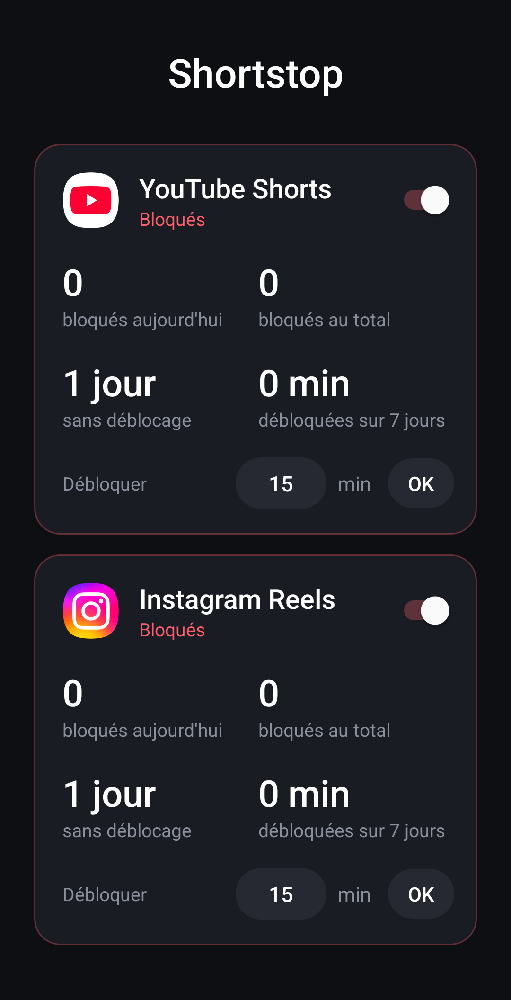

<p align="center">
  
</p>

<h1 align="center">Shortstop</h1>

<p align="center">Bloque les Shorts YouTube et les Reels Instagram, sans bloquer le reste des deux apps.</p>

Petite app Android perso, sans compte ni réseau.

Dès qu'un Short ou un Reel s'ouvre, l'app fait automatiquement « retour » et affiche un bandeau discret « Short bloqué » ou « Reel bloqué ». Tout reste sur le téléphone.

<p align="center">
  
</p>

## Ce qui est bloqué

**YouTube**

| Écran | Comportement |
|---|---|
| Onglet Shorts, Short ouvert depuis l'accueil ou la recherche | Bloqué (retour) |
| Vidéos classiques, accueil, abonnements, recherche | Autorisé |

**Instagram**

| Écran | Comportement |
|---|---|
| Onglet « For you » de l'accueil | Bascule automatiquement sur « Feed » |
| Lecteur Reels plein écran (depuis le fil, la recherche...) | Bloqué (retour) |
| Reel reçu en message privé | Autorisé, autant de fois qu'on veut |
| Reel suivant, après celui reçu en message | Bloqué, retour à la conversation |
| Fil d'accueil, vidéos lues dans le fil, stories, messages | Autorisé |

## Fonctionnalités

- **Deux modules indépendants.** YouTube et Instagram ont chacun leur interrupteur, leurs règles et leurs statistiques.
- **Déblocage temporaire.** On choisit une durée en minutes (de 1 à 600) et l'app concernée est débloquée jusqu'à l'heure de fin. À la fin, la vidéo en cours peut être terminée ; le blocage reprend à la suivante. « Rebloquer maintenant » arrête le déblocage avant la fin.
- **Statistiques par app.** Vidéos bloquées aujourd'hui et au total, nombre de jours sans déblocage, minutes débloquées sur les 7 derniers jours.
- **Alerte si le blocage s'arrête.** Une notification prévient si le service d'accessibilité est désactivé ou coupé par le système. La toucher ouvre directement les réglages pour le réactiver.

## Installation

L'app n'est pas sur le Play Store : on la compile et on l'installe soi-même.

### Prérequis

- Android Studio (ou un JDK 17 à 21 et le SDK Android)
- Un téléphone Android 8 ou plus récent, avec le **débogage USB** activé (Paramètres → À propos du téléphone → Informations sur le logiciel → appuyer 7 fois sur « Numéro de version », puis Options de développement → Débogage USB)

### Compiler et installer

Depuis Android Studio : ouvrir le dossier du projet, brancher le téléphone, cliquer sur **Run**.

En ligne de commande :

```sh
./gradlew assembleDebug
adb install -r app/build/outputs/apk/debug/app-debug.apk
```

Sur Windows, utiliser `gradlew.bat` à la place de `./gradlew`.

### Activer le blocage sur le téléphone

1. **Autoriser les paramètres restreints** (Android 13 et plus) : Paramètres → Applications → Shortstop → menu ⋮ → « Autoriser les paramètres restreints ». Android l'exige pour les apps installées hors Play Store.
2. **Activer le service** : Paramètres → Accessibilité → Applications installées → Shortstop.
3. **Désactiver l'optimisation de batterie** : Paramètres → Applications → Shortstop → Batterie → « Non restreinte ». Sinon, certains fabricants (Samsung notamment) peuvent couper le service.
4. **Désactiver « Gérer l'appli si inutilisée »** dans la même page, pour qu'Android ne retire pas les autorisations si l'app n'est pas ouverte pendant plusieurs mois.
5. Accepter les notifications au premier lancement, pour être prévenu si le blocage s'arrête.

Sur Samsung, si l'installation par câble est refusée, désactiver temporairement le « Blocage automatique » (Paramètres → Sécurité et confidentialité).

## Comment ça marche

L'app utilise un **service d'accessibilité** Android. Il est limité à YouTube et Instagram : Android ne le réveille que lorsque l'une de ces deux apps est à l'écran.

À chaque changement d'écran, le service lit l'arborescence des éléments affichés et cherche des identifiants caractéristiques, comme `reel_recycler` pour le lecteur Shorts de YouTube ou `clips_viewer_view_pager` pour le lecteur Reels d'Instagram. S'il en trouve un, il bloque.

Pour reconnaître un Reel reçu en message, le service vérifie la présence de la barre de l'expéditeur et du champ de réponse (`sender_username_or_fullname`, `reply_bar_edittext`), qu'Instagram n'affiche que dans ce cas.

Pour laisser finir la vidéo en cours après un déblocage, chaque module calcule une « signature » de la vidéo affichée : auteur et légende sur Instagram, position dans la liste sur YouTube. Le blocage reprend dès que la signature change.

### Structure du code

```
app/src/main/java/com/perso/shortstop/
├── BlockerService.kt     Service d'accessibilité : reçoit les événements, délègue aux modules, affiche le bandeau
├── Blocker.kt            Classe de base d'un module de blocage
├── YouTubeBlocker.kt     Règles YouTube
├── InstagramBlocker.kt   Règles Instagram
├── Prefs.kt              Réglages et statistiques (SharedPreferences)
├── Watchdog.kt           Surveillance du service et notification
└── MainActivity.kt       Écran principal
```

## Quand YouTube ou Instagram change

Les identifiants d'éléments d'écran peuvent changer lors d'une mise à jour de YouTube ou d'Instagram. Si le blocage ne fonctionne plus :

1. Dans Shortstop, faire un **appui long sur le titre** pour activer le mode debug.
2. Ouvrir l'écran qui pose problème. Le service écrit alors l'arborescence de l'écran dans Logcat :
   ```sh
   adb logcat -s Shortstop
   ```
   On peut aussi capturer l'écran directement avec `adb shell uiautomator dump` (mettre la vidéo en pause avant, sinon la capture échoue).
3. Repérer le nouvel identifiant et l'ajouter dans `YouTubeBlocker.kt` ou `InstagramBlocker.kt`.
4. Désactiver le mode debug avec un nouvel appui long.

## Ajouter une autre app

1. Créer une classe qui hérite de `Blocker`, sur le modèle de `YouTubeBlocker.kt`.
2. L'ajouter à la liste `BLOCKERS` dans `BlockerService.kt`.
3. Ajouter son package dans `android:packageNames` de `res/xml/accessibility_config.xml`, et dans la section `<queries>` du manifeste pour afficher son icône.
4. Ajouter sa carte dans `MainActivity.kt`.

## Vie privée

- Aucune permission réseau : l'app ne peut rien envoyer.
- Le service ne lit que les écrans de YouTube et d'Instagram, et ne conserve rien de ce qu'il y voit.
- Les seules données stockées sont les réglages et les compteurs, sur le téléphone.

## Limites connues

- Les règles dépendent de la structure interne des apps ciblées. Elles ont été établies sur YouTube et Instagram en novembre 2026 et peuvent nécessiter une mise à jour par la suite.
- Les textes recherchés pour l'onglet « Feed » d'Instagram couvrent l'anglais et le français.
